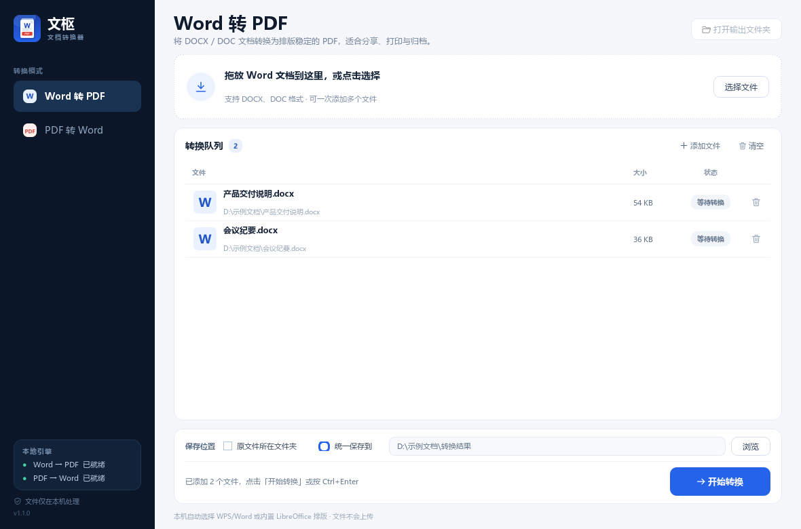
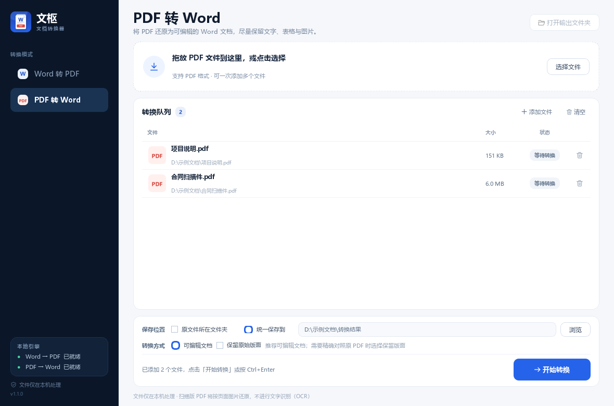

# 文枢文档转换器

一个在 Windows 上本地运行的 Word ⇄ PDF 双向转换工具。支持批量拖放、取消任务、输出位置管理和错误详情，界面使用中文。



## 功能

- **Word 转 PDF**：支持 DOCX 与 DOC，保留字体、段落、表格、图片、页眉页脚与分页。优先调用本机 WPS/Word 的排版引擎，字体和分页更接近原文档。
- **PDF 转 Word**：提供「可编辑文档」和「保留原始版面」两种模式。默认按阅读顺序重排为普通段落、标题、表格和图片，便于继续编辑。
- **批量转换**：一次添加多个文件，按队列顺序处理。
- **不覆盖已有文件**：同名时自动生成“文件名 (1).pdf”或“文件名 (1).docx”。
- **本地处理**：文件不会上传到网络。
- **可取消**：转换在独立子进程中运行，可随时停止，不会卡住界面。
- **清晰的错误提示**：失败文件标红，可查看完整错误详情后重试。

## 直接使用

1. 解压发布包（或直接打开发布文件夹）。
2. 双击 **WenShuConverter.exe**。
3. 在左侧选择「Word 转 PDF」或「PDF 转 Word」。
4. 拖入文件（或点击「选择文件」），确认保存位置后点击「开始转换」。
5. 转换完成后，右上角「打开输出文件夹」可定位结果。

快捷键：Ctrl+O 添加文件，Ctrl+Enter 开始转换。

发布版已内置 LibreOffice 引擎和 PDF 解析组件，**不需要安装 Microsoft Word、LibreOffice 或 Python**。如果本机安装了 WPS Office 或 Microsoft Word，Word 转 PDF 会优先使用它们，以更准确地还原字体和分页；没有时自动使用内置 LibreOffice。

> 这是未签名的个人工具。Windows SmartScreen 可能提示「Windows 已保护你的电脑」，此时点击「更多信息」→「仍要运行」即可。

## 界面预览

| Word 转 PDF | PDF 转 Word |
| --- | --- |
|  |  |

## 使用范围与限制

- Windows 10 / 11，64 位。
- Word 转 PDF 优先使用本机 WPS/Word；如果未安装，则由内置 LibreOffice 完成，分页和字体渲染可能有细微差异。
- 如果文档使用了本机未安装的字体，任何转换器都无法凭空显示该字体；请先安装对应字体。程序会在状态提示中给出缺少字体的信息。
- PDF 转 Word 的「可编辑文档」会按阅读顺序重排内容，因此不再精确保留原 PDF 的分页和浮动位置；需要对照原版式时请选择「保留原始版面」。
- 扫描版 PDF 会按页面图片还原，**不做文字识别（OCR）**。若需要可编辑文字，请先使用 OCR 工具。
- 加密 PDF 需要先解除密码保护；受密码保护的 Word 文档也需要先解除保护。
- 复杂 PDF（多栏排版、大量文本框、特殊字体）可能出现位置偏差，建议转换后检查结果。
- 转换结果默认保存到源文件所在文件夹；也可以在界面中选择统一的输出文件夹。

## 从源码运行

环境：Python 3.12（64 位）。

```powershell
cd WenShuConverter
python -m pip install -r requirements.txt
python launcher.py
```

或双击 run.bat。

源码运行时，如果 engine 目录不存在，程序会尝试使用本机 WPS/Word COM、系统安装的 LibreOffice，或本机上 DSH 自带的 LibreOffice Kit。对外发布前请执行引擎打包步骤。

## 构建 Windows 发布版

```powershell
# 一次性安装构建依赖
python -m pip install -r requirements-dev.txt

# 组装内置 LibreOffice 引擎（需要本机有 DSH 的 LibreOffice Kit）
python tools\prepare_engine.py

# 构建，并可选生成 ZIP
.\build.ps1 -Zip
```

也可以使用 .\build.ps1 -RefreshEngine -Zip 重新复制引擎后再打包。

构建结果：

- dist\WenShuConverter\WenShuConverter.exe
- dist\WenShuConverter\engine\（内置转换引擎）
- dist\WenShuConverter-Windows-x64.zip（使用 -Zip 时生成）

build.ps1 会复制 engine 和说明文件到发布目录。PyInstaller 使用 WenShuConverter.spec 配置。

## 项目结构

```text
WenShuConverter/
├─ launcher.py             入口：GUI 或转换子进程
├─ app_ui.py               PySide6 主界面、队列与工作线程
├─ conversion.py           Word/PDF 转换核心与引擎检测
├─ pdf_flow.py             PDF 可编辑重排引擎
├─ worker.py               隔离的单文件转换进程
├─ widgets.py              拖放区、文件行、状态标签等组件
├─ icons.py                绘制图标与文件徽标
├─ theme.py                全局样式
├─ assets/                 应用图标
├─ engine/                 便携 LibreOffice 引擎（构建时生成）
├─ tools/prepare_engine.py 组装内置引擎
├─ tests/                  开发测试脚本与样例生成器
├─ WenShuConverter.spec    PyInstaller 构建配置
├─ build.ps1               一键构建脚本
└─ requirements*.txt
```

## 转换引擎说明

- **Word → PDF**：优先使用 WPS Office / Microsoft Word 的 COM 排版引擎；不可用时回退到 LibreOffice（系统安装版或内置的 LibreOffice Kit），使用无界面模式，不会弹出文档窗口。
- **PDF → Word 可编辑模式**：PyMuPDF 负责解析文字、图片和表格，再由本程序重排为普通 Word 段落；不依赖浮动文本框。
- **PDF → Word 版面模式**：pdf2docx（MIT），尽量保持原 PDF 的位置关系。
- 内置引擎由 Node.js 和 LibreOffice Kit 组成，仅在本机运行。

第三方组件与许可证摘要见 THIRD_PARTY_NOTICES.md。如果要对外商业分发，请特别复核 PyMuPDF 的 AGPL 条款，或向 Artifex 获取商业授权。

## 常见问题

**双击后没有窗口？**
请确认使用 WenShuConverter.exe 而不是解压包中的其他文件；首次启动会稍慢。若仍无响应，查看 %LOCALAPPDATA%\WenShuConverter\logs\app.log。

**提示「没有找到 Word 转 PDF 引擎」？**
确认 engine 文件夹与 exe 位于同一目录；或安装 LibreOffice，并在提示框中选择 soffice.exe。

**PDF 转 Word 排版乱了？**
请确认「转换方式」选择的是「可编辑文档」，它会按阅读顺序重排为普通段落，通常比保留版面的模式更适合继续编辑。若需要与 PDF 逐页对照，再选择「保留原始版面」。

**Word 转 PDF 字体显示不全？**
请先安装文档使用的字体。程序会优先调用本机 WPS/Word 导出 PDF；如果本机没有 WPS/Word，再使用内置 LibreOffice。状态提示中会尽量报告缺失的字体名称。

**扫描件可以转吗？**
可以输出按页图片组成的 Word，但不能直接编辑文字。需要可编辑文字时请先 OCR。

**文件会传到网上吗？**
不会。程序不发起网络请求，文件仅在本机读写。

## 发布到 GitHub

仓库只提交源码、图标、文档和构建脚本，**不提交**以下大体积目录：

- `dist/`：约 594 MB 的已打包程序
- `engine/`：约 280 MB 的便携 LibreOffice 引擎
- `build/`：PyInstaller 中间文件

这是因为 GitHub 对单个文件有 100 MB 限制，普通 Git 提交不适合存放运行包。发布可执行版本时，请把构建产物作为 **GitHub Release 附件**上传，而不是提交到仓库。

### 1. 提交源码

```powershell
cd D:\Project\WenShuConverter
git init -b main
git remote add origin https://github.com/ljj985211-oss/WenShuConverter.git
git fetch origin main
git reset --soft origin/main
git add .
git status
git commit -m "feat: Word/PDF converter v1.1.0"
git push -u origin main
```

`git status` 中不应出现 `dist/` 和 `engine/`；如果出现，说明 `.gitignore` 没有生效。

### 2. 生成可分发的 ZIP

```powershell
.\build.ps1 -Zip
```

输出文件为 `dist\WenShuConverter-Windows-x64.zip`，其中包含程序、内置引擎和说明文档。

### 3. 创建 GitHub Release

1. 打开仓库的 **Releases** → **Draft a new release**。
2. Tag 填 `v1.1.0`，标题填 `文枢文档转换器 v1.1.0`。
3. 上传 `dist\WenShuConverter-Windows-x64.zip`。
4. 填写更新说明并点击 **Publish release**。

GitHub Release 单个附件上限为 2 GB，本项目的 ZIP 远低于该限制。
